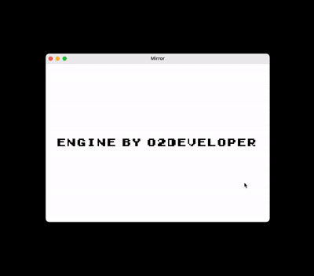

<div align="center">
  <h1>Mirror</h1>
</div>

<p align="center">
  <a href="logo.png">
    
  </a>
  <br>
</p>

## Overview
A 16-bit game that helps you practice having difficult conversations.

## Demo
Below is a demo of the game in action.

<p align="center">
  <a href="demo.gif">
    
  </a>
  <br>
</p>


## Setup

- [ ] **Install Java 21 (OpenJDK)**

    Mirror requires **Java 21** to run its game engine and local AI model. I recommend installing **Eclipse Temurin OpenJDK 21**, which is free and available for Windows, macOS, and Linux.

    **Download Java 21 here:** https://adoptium.net/temurin/releases/?version=21

    ### Windows
    1. Open the download link above.
    2. Select **Windows** as your operating system.
    3. Select **JDK 21 (LTS)**.
    4. Download the `.msi` installer for your system (usually x64).
    5. Run the installer and enable **Add to PATH** if prompted.
    6. Restart Command Prompt and verify your installation:

       ```bash
       java -version
       ```

    ### macOS
    1. Open the download link above.
    2. Select **macOS** as your operating system.
    3. Select **JDK 21 (LTS)**.
    4. Choose **aarch64** for Apple Silicon or **x64** for Intel Macs.
    5. Download and run the `.pkg` installer.
    6. Open Terminal and verify your installation:

       ```bash
       java -version
       ```

    **Alternatively, install Java 21 using Homebrew:**

    ```bash
    brew install openjdk@21
    ```

    ### Linux
    On supported Ubuntu/Debian distributions, install OpenJDK 21 with:

    ```bash
    sudo apt update
    sudo apt install openjdk-21-jdk
    ```

    Verify the installation:

    ```bash
    java -version
    ```

- [ ] **Verify your Java version**

    Java 21 is recommended for compatibility with Mirror's AI inference engine.

    For reference, this is the Java version installed on my laptop:

    ```text
    openjdk version "21.0.9" 2025-10-21
    OpenJDK Runtime Environment Homebrew (build 21.0.9)
    OpenJDK 64-Bit Server VM Homebrew (build 21.0.9, mixed mode, sharing)
    ```

    Your exact patch version may differ. Any current **Java 21** release should be suitable.

- [ ] **Download and run Mirror**

    1. Download `mirror.jar` from the project's GitHub Releases page.
    2. Make sure Java 21 is installed.
    3. Open a terminal or Command Prompt in the folder containing `mirror.jar`.
    4. Run:

       ```bash
       java -jar mirror.jar
       ```

    **Note:** Mirror includes its local AI model and tokenizer inside the JAR. You do not need to install Python, Eclipse, or download the model separately.

    An internet connection is not required for gameplay once the game and Java are installed.

## Gameplay


### Controls

| Key | Action |
|-----|--------|
| `W` or `↑` | Move Up |
| `A` or `←` | Move Left |
| `S` or `↓` | Move Down |
| `D` or `→` | Move Right |
| `E` | Talk to a Friend |

### How to Play

1. Use **W, A, S, D** or the **arrow keys** to move around your shared suite.
2. Explore the suite and find your friends.
3. Approach a friend and press **E** to start a conversation.
4. Type your message in the chatbox to interact with your friend.
5. Type switch in the chatbox to chat from your friends perspective.
6. Press quit to return to your shared suite.

Explore, communicate, and experience the world of **Mirror**!
## Credits

**Mirror** was created and developed by:

- Ariana Cota (Project Management, Supported Finetuning Tiny Langauge Model, Testing and Evaluating Game)
- Madeleinne Tan (Game Artist, Web Development, Supported fine tuning Tiny Language Model, Testing and Evaluating Game)
- Puneet Kumar Bokka (Web Development, Testing and Evaluating Game, Supported finetuning tiny language model, Fixing Bugs)
- Ethan Register (Game Development, Pretraining and Finetuning Tiny Language Model, Testing and Evaluating Game, Fixing Bugs)

Thank you to the organizers of Hacks for Humanity and to the wonderful team who contributed to bringing Mirror to life!
